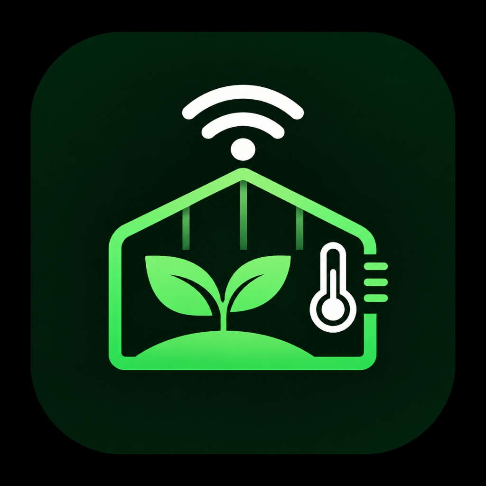

# 🌱 AgroLink - Gestão Inteligente de Estufas Automatizadas



> **AgroLink** é uma plataforma completa e moderna de monitoramento agronômico, telemetria em tempo real e controle de estufas agrícolas automatizadas. Desenvolvido para o produtor rural que necessita de máxima confiabilidade mesmo em locais sem infraestrutura de internet fixa, o sistema conecta o microcontrolador **Arduino Uno** via **Bluetooth Clássico (HC-05)** ao aplicativo **Android dedicado (AgroLink .APK)**, contando com um inovador **Sistema de Data Logging Offline (estilo Smartwatch)**, display LCD I2C, medição ultrassônica do reservatório de água e travas de segurança ativas.

---

## 📌 Sumário
- [Destaques do Projeto](#-destaques-do-projeto)
- [Arquitetura do Sistema](#-arquitetura-do-sistema)
- [Tabela Oficial de Pinagem (Arduino Uno)](#-tabela-oficial-de-pinagem-arduino-uno)
- [Circuito do Módulo Bluetooth HC-05](#-circuito-do-módulo-bluetooth-hc-05)
- [Sistema de Log Offline e Sincronização em Lote](#-sistema-de-log-offline-e-sincronização-em-lote)
- [Protocolo de Comandos e Telemetria](#-protocolo-de-comandos-e-telemetria)
- [Travas de Segurança e Parâmetros Agronômicos](#-travas-de-segurança-e-parâmetros-agronômicos)
- [Padrões Sonoros do Alarme (Buzzer - Pino 11)](#-padrões-sonoros-do-alarme-buzzer---pino-11)
- [Aplicativo Mobile AgroLink (Android APK)](#-aplicativo-mobile-agrolink-android-apk)
- [Manual de Instalação, Compilação e Uso](#-manual-de-instalação-compilação-e-uso)

---

## 🚀 Destaques do Projeto

- **Comunicação Bluetooth Direta (Sem Necessidade de Wi-Fi ou Roteador):** Conexão ponto a ponto segura entre o celular do produtor e a estufa via perfil serial SPP (*Serial Port Profile*).
- **Detecção em Tempo Real de Conexão (Pino 8 - STATE):** O microcontrolador monitora continuamente o pino de estado do HC-05 com filtro anti-ruído (debounce de 80 ms), sabendo exatamente quando o celular está por perto ou fora de alcance.
- **Log Offline na Memória RAM (Estilo Smartwatch):** Enquanto o celular estiver desconectado, o Arduino continua monitorando os sensores e compacta as leituras em um buffer circular interno. Ao reconectar, descarrega todo o histórico automaticamente para o celular.
- **Sensor Ultrassônico no Reservatório:** Cálculo em tempo real do volume de água (0% a 100%) e distância da lâmina d'água.
- **Trava de Segurança Contra Queima a Seco:** A bomba d'água é terminantemente bloqueada se o nível do reservatório estiver crítico ($\le$ 15%), tanto em modo automático quanto por acionamento manual.
- **Interface Android de Alto Padrão:** Layout com identidade visual própria (design system escuro com tons de verde e ciano), barra de status do sistema preservada (relógio e bateria visíveis), gráficos históricos em Canvas com filtros Dia/Mês e representação real de lacunas offline (sem interpolações fictícias).

---

## 🏛️ Arquitetura do Sistema

```
┌──────────────────────────────────────────────────────────────────────────────┐
│                    APLICATIVO ANDROID "AGROLINK" (APK)                       │
│  - Painel de Telemetria em Tempo Real       - Banco de Dados Local           │
│  - Gráficos Históricos (Dia / Mês)          - Gestão Multi-Estufas           │
│  - Controles Manuais com Debounce           - Sincronização de Dados         │
└──────────────────────────────────────┬───────────────────────────────────────┘
                                       │
                                       │ Conexão Sem Fio Bluetooth Clássico
                                       │ Perfil Serial SPP (RFCOMM)
                                       ▼
┌──────────────────────────────────────────────────────────────────────────────┐
│ UNIDADE DA ESTUFA (ARDUINO UNO R3 - ATmega328P)                              │
│                                                                              │
│   ┌───────────────────────────┐                ┌─────────────────────────┐   │
│   │ MÓDULO BLUETOOTH HC-05    │                │ DISPLAY LCD 16x2 I2C    │   │
│   │ - RX (Pino 3 via divisor) │                │ - Endereço 0x27         │   │
│   │ - TX (Pino 2 direto)      │                │ - SDA: Pino A4          │   │
│   │ - STATE: Pino 8 (Status)  │                │ - SCL: Pino A5          │   │
│   └─────────────┬─────────────┘                └────────────▲────────────┘   │
│                 │                                           │                │
│                 ▼                                           │                │
│   ┌─────────────────────────────────────────────────────────┴────────────┐   │
│   │ NÚCLEO DO FIRMWARE (estufa_arduino_uno.ino)                          │   │
│   │ - Monitoramento de STATE (HIGH = Conectado / LOW = Offline)          │   │
│   │ - Data Logging em RAM Buffer (70 registros x 6 bytes)                │   │
│   │ - Descarregamento em lote não-bloqueante com Watchdog Timer          │   │
│   │ - Automação Agronômica e Intertravamento de Segurança                │   │
│   └──────┬──────────────────────┬─────────────────────────┬──────────────┘   │
│          │                      │                         │                  │
│          ▼                      ▼                         ▼                  │
│   ┌──────────────┐       ┌──────────────┐          ┌──────────────┐          │
│   │ SENSORES     │       │ ATUADORES    │          │ SEGURANÇA    │          │
│   │ - DHT11 (D6) │       │ - Bomba (D10)│          │ - Trava Seco │          │
│   │ - Solo (A0)  │       │ - Vento (D13)│          │ - Buzzer(D11)│          │
│   │ - Ultra(D4/5)│       │              │          │ - WDT 8s     │          │
│   └──────────────┘       └──────────────┘          └──────────────┘          │
└──────────────────────────────────────────────────────────────────────────────┘
```

---

## 🔌 Tabela Oficial de Pinagem (Arduino Uno)

| Componente | Tipo de Sinal | Pino Arduino | Descrição / Função |
| :--- | :--- | :---: | :--- |
| **Bluetooth HC-05 (TX)** | Serial Entrada | **Pino 2 (RX)** | Recebe dados do módulo HC-05 via `SoftwareSerial` |
| **Bluetooth HC-05 (RX)** | Serial Saída | **Pino 3 (TX)** | Envia dados ao HC-05 *(utilizar divisor de tensão 5V $\to$ 3.3V)* |
| **Bluetooth HC-05 (STATE)** | Digital Entrada | **Pino 8** | Leitura contínua: **HIGH = Conectado** / **LOW = Modo Offline** |
| **Sensor DHT11** | Digital Bidirecional | **Pino 6** | Mede Temperatura do Ar (°C) e Umidade Relativa (%) |
| **Higrômetro de Solo** | Analógico | **Pino A0** | Leitura de condutividade da terra calibrada de 0% a 100% |
| **Sensor Ultrassônico (TRIG)**| Digital Saída | **Pino 4** | Emissão de pulso ultrassônico (HC-SR04) |
| **Sensor Ultrassônico (ECHO)**| Digital Entrada | **Pino 5** | Recepção do eco para cálculo da distância da água (cm) |
| **Bomba d'Água (Relé)** | Digital Saída | **Pino 10** | Controle da bomba de irrigação *(com trava contra queima a seco)* |
| **Alarme Sonoro (Buzzer)** | Digital (PWM) | **Pino 11** | Bipes harmônicos de conexão, status e alarme de nível crítico |
| **Ventoinha / Cooler (Relé)**| Digital Saída | **Pino 13** | Exaustão e resfriamento térmico da estufa |
| **Display LCD 16x2 I2C** | Barramento I2C | **A4 (SDA) / A5 (SCL)** | Telinha de cristal líquido no endereço `0x27` com ícones customizados |

---

## ⚡ Circuito do Módulo Bluetooth HC-05

O módulo HC-05 opera com nível lógico de **3.3V** no seu pino de recepção (RX). Como as saídas digitais do Arduino Uno fornecem **5V**, é mandatório utilizar um divisor resistivo de tensão para preservar a integridade do módulo:

```
Pino 3 (TX do Arduino) ───[ Resistor 1kΩ ]───┬───► Pino RX do HC-05 (3.3V Seguro)
                                             │
                                     [ Resistor 2kΩ ]
                                             │
                                            GND
```

- **Pino TX do HC-05:** Conectado diretamente ao **Pino 2 (RX do Arduino)** (o Arduino Uno reconhece 3.3V como nível lógico ALTO de forma confiável).
- **Pino STATE do HC-05:** Conectado diretamente ao **Pino 8 do Arduino** com resistor pull-down interno/configuração digital estável.
- **Alimentação:** VCC do HC-05 conectado ao pino **5V** do Arduino e GND compartilhado.

---

## 🔄 Sistema de Log Offline e Sincronização em Lote

### 1. Detecção Automática pelo Pino 8 (STATE)
- **Celular Desconectado (Pino 8 LOW):**
  - O sistema emite o bipe sonoro de desconexão.
  - A cada **25 segundos**, o firmware realiza uma leitura completa de todos os sensores e armazena os dados em uma `struct` compacta na memória RAM:
  ```cpp
  struct RegistroOffline {
    uint16_t offsetSegundos; // Tempo decorrido desde a desconexão
    int8_t temp;             // Temperatura (-40 a 125 °C)
    uint8_t umidAr;          // Umidade do Ar (0 a 100%)
    uint8_t umidSolo;        // Umidade do Solo (0 a 100%)
    uint8_t nivelAgua;       // Nível do Reservatório (0 a 100%)
    uint8_t bomba : 1;       // Estado da Bomba (0 ou 1)
    uint8_t ventoinha : 1;   // Estado da Ventoinha (0 ou 1)
  };
  ```
  - **Eficiência de Memória:** Cada registro ocupa apenas **6 bytes**. O buffer de 70 amostras consome apenas **420 bytes de RAM** (muito seguro para os 2.048 bytes de SRAM do ATmega328P).

- **Reconexão do Celular (Pino 8 transita para HIGH):**
  - O Arduino toca a melodia de boas-vindas (`soarBipeConexaoSucesso()`).
  - Exibe mensagem imediata no LCD: `"BT Conectado!"`.
  - Inicia imediatamente o descarregamento do lote offline para o aplicativo Android.

### 2. Protocolo de Descarregamento em Lote (*Batch Sync*)
```
Arduino Uno (HC-05)                            Aplicativo Android (AgroLink)
        │                                                     │
        │─── {"sync_start": 42} ─────────────────────────────►│ Abre banner de progresso
        │                                                     │
        │─── {"sync_item":{"t_offset":1050,"temp":24.5,...}} ─►│ Calcula timestamp real
        │─── {"sync_item":{"t_offset":1025,"temp":24.6,...}} ─►│ Grava no Banco Local
        │    (envio sequencial linha a linha)                 │
        │                                                     │
        │─── {"sync_end": true, "count": 42} ────────────────►│ Conclui sincronização,
        │                                                     │ atualiza gráficos e UI
```

> **Garantia de Não-Travamento:** Durante o laço de envio do lote offline, o Arduino executa `wdt_reset()` e `verificarComandosSeriais()` a cada linha enviada. Isso garante que comandos manuais enviados pelo produtor (como desligar a bomba ou ligar a ventoinha) sejam executados instantaneamente sem aguardar o fim do descarregamento.

---

## 📡 Protocolo de Comandos e Telemetria

### 1. Comandos de Controle Rápido (ASCII e JSON)
O firmware possui um decodificador híbrido tolerante a falhas que aceita tanto códigos curtos quanto payloads JSON:

| Ação Desejada | Código ASCII Rápido | Comando JSON | Resposta do Arduino (ACK) |
| :--- | :---: | :--- | :--- |
| **Ligar Bomba d'Água** | `B1` | `{"cmd":"bomba","val":1}` | `{"ack":"bomba","estado":1,"status":"ok"}` |
| **Desligar Bomba d'Água**| `B0` | `{"cmd":"bomba","val":0}` | `{"ack":"bomba","estado":0,"status":"ok"}` |
| **Alternar Bomba** | `B` | `bomba_toggle` | `{"ack":"bomba","estado":X,"status":"ok"}` |
| **Ligar Ventoinha** | `V1` | `{"cmd":"ventoinha","val":1}`| `{"ack":"ventoinha","estado":1,"status":"ok"}` |
| **Desligar Ventoinha** | `V0` | `{"cmd":"ventoinha","val":0}`| `{"ack":"ventoinha","estado":0,"status":"ok"}` |
| **Alternar Ventoinha** | `V` | `ventoinha_toggle` | `{"ack":"ventoinha","estado":X,"status":"ok"}` |
| **Ativar Auto Bomba** | `A1` | `{"cmd":"auto_bomba","val":1}`| `{"ack":"auto_bomba","estado":1,"status":"ok"}` |
| **Desativar Auto Bomba**| `A0` | `{"cmd":"auto_bomba","val":0}`| `{"ack":"auto_bomba","estado":0,"status":"ok"}` |
| **Ativar Auto Ventoinha**| `C1` | `{"cmd":"auto_ventoinha","val":1}`| `{"ack":"auto_ventoinha","estado":1,"status":"ok"}` |
| **Desativar Auto Ventoinha**| `C0` | `{"cmd":"auto_ventoinha","val":0}`| `{"ack":"auto_ventoinha","estado":0,"status":"ok"}` |
| **Forçar Sincronização**| `S` | `{"cmd":"sync"}` | Inicia `{"sync_start":N}` |
| **Solicitar Telemetria**| `T` | `{"cmd":"status"}` | Pacote completo de telemetria |

### 2. Pacote de Telemetria Contínua (Enviado a cada 2 segundos)
```json
{
  "temp": 24.8,
  "umidade_ar": 65,
  "umidade_solo": 72,
  "nivel_agua": 85,
  "status_agua": "OK",
  "dist_cm": 7,
  "bomba": 0,
  "ventoinha": 0,
  "auto_bomba": 1,
  "auto_ventoinha": 1,
  "bt_online": 1
}
```

---

## 🛡️ Travas de Segurança e Parâmetros Agronômicos

1. **Trava Crítica do Reservatório (Proteção Anti-Queima a Seco):**
   - Se o sensor ultrassônico detectar que o reservatório está com **$\le$ 15% de água** (ou status `"BAIXO"`):
     - A bomba d'água é **imediatamente desligada** caso esteja ligada.
     - Qualquer tentativa manual ou automática de acionar a bomba é rejeitada pelo Arduino, que responde `{"ack":"bomba","estado":0,"status":"bloqueado_sem_agua"}`.
     - O Buzzer emite alertas periódicos e o display exibe `"Res. Sem Agua!"`.
2. **Umidade do Solo (Capacidade de Campo Ideal: 60% a 80%):**
   - **Solo Seco (< 40%):** Se o modo automático estiver ativo e houver água segura no reservatório, a bomba é ligada automaticamente.
   - **Solo Satisfeito ($\ge$ 75%):** A bomba é desligada, evitando saturação e apodrecimento radicular.
3. **Temperatura do Ar (Ideal: 20°C a 30°C):**
   - **Estresse Térmico (> 30.0°C):** A ventoinha liga para resfriar a estufa.
   - **Resfriamento Concluído ($\le$ 27.0°C):** A ventoinha é desligada automaticamente.
4. **Proteção por Hardware (Watchdog Timer - WDT 8s):**
   - Em caso de falha transitória ou travamento de sensor no barramento, o microcontrolador é reinicializado automaticamente em até 8 segundos, restaurando as saídas para nível seguro.

---

## 🎵 Padrões Sonoros do Alarme (Buzzer - Pino 11)

- **Bipe Curto (2000 Hz, 70 ms):** Confirmação de recebimento e execução de comando serial.
- **Melodia de Conexão (2200 Hz $\to$ 2700 Hz):** Executada no instante em que o celular conecta ao HC-05 (Pino 8 HIGH).
- **Melodia de Desconexão (1200 Hz $\to$ 800 Hz):** Executada quando o celular se afasta ou desconecta (Pino 8 LOW).
- **Alarme de Nível Crítico (950 Hz, 180 ms intermitente):** Avisa o agricultor que o reservatório de água necessita de reabastecimento urgente.

---

## 📱 Aplicativo Mobile AgroLink (Android APK)

- **Semáforo Visual de Conexão Bluetooth:**
  - ⚪ **Cinza:** Módulo desconectado. Toque para conectar.
  - 🔵 **Azul Pulsante:** Conectando / Sincronizando lote offline em segundo plano.
  - 🟢 **Verde:** Conectado em tempo real.
- **Gráficos Históricos em Canvas com Filtro Dia/Mês:**
  - Exibe a evolução da Temperatura do Ar, Umidade do Ar e Umidade do Solo.
  - **Tratamento Rigoroso de Períodos Offline:** Caso a estufa tenha ficado desligada da tomada, o gráfico exibe o período em **linha pontilhada/quebrada**, refletindo com 100% de precisão os momentos sem comunicação sem inventar curvas falsas.
- **Banco de Dados Local (IndexedDB / SQLite):**
  - Armazena milhares de leituras históricas no armazenamento local do próprio celular, funcionando de forma rápida e sem depender de nuvem paga.
- **Blocos Interativos de Atuadores:**
  - Visual em cubo com cantos arredondados e iluminação temática (Azul para a Bomba d'Água com animação de água caindo; Roxo para a Ventoinha com rotação suave).
  - Estado intermediário piscante (`waiting`) enquanto aguarda confirmação do microcontrolador.

---

## 🔧 Manual de Instalação, Compilação e Uso

### 1. Gravação do Firmware no Arduino Uno
1. Baixe e instale a [Arduino IDE](https://www.arduino.cc/en/software) (versão 1.8.x ou 2.x).
2. Pelo Gerenciador de Bibliotecas da IDE, instale:
   - `DHT sensor library` (por Adafruit)
   - `LiquidCrystal_I2C` (por Frank de Brabander)
3. Abra o arquivo [`estufa_arduino_uno.ino`](estufa_arduino_uno.ino).
4. Em **Ferramentas**:
   - Placa: **Arduino Uno**
   - Porta: Selecione a porta COM correspondente ao seu cabo USB.
5. Clique em **Carregar** (ícone de seta).
6. O display LCD ligará e exibirá `"AgroLink Estufa - Bluetooth HC-05"`.

> **Dica Importante:** Durante o upload via USB, o módulo Bluetooth nos pinos 2 e 3 não interfere na gravação, pois a comunicação utiliza `SoftwareSerial`.

### 2. Pareamento do Módulo HC-05 no Android
1. No seu celular Android, vá em **Configurações > Bluetooth**.
2. Ative o Bluetooth e procure por novos dispositivos.
3. Selecione o dispositivo chamado **HC-05** (ou similar).
4. Quando solicitado o PIN de pareamento, digite **`1234`** ou **`0000`**.
5. O módulo agora constará na lista de "Dispositivos Pareados".

### 3. Geração e Instalação do Aplicativo Android (.APK)
1. Abra o **Android Studio**.
2. Clique em **File > Open** e selecione a pasta `android/` deste repositório.
3. Aguarde o Gradle sincronizar os pacotes e dependências.
4. Conecte seu celular Android ao computador via USB (com Depuração USB ativada) ou vá no menu superior:
   - **Build > Build Bundle(s) / APK(s) > Build APK(s)**.
5. Ao concluir, clique no aviso que surge no canto inferior: **locate**.
6. O arquivo gerado estará em:
   `android/app/build/outputs/apk/debug/app-debug.apk`
7. Transfira para o seu celular Android e instale!

---

## 📄 Documentação Acadêmica Completa

Para entrega de relatórios acadêmicos, trabalhos de conclusão (TCC) ou apresentação formal com formatação ABNT/IEEE, utilize o arquivo gerado:
- **[`documentacao_agrolink.html`](documentacao_agrolink.html)**: Arquivo HTML auto-contido, com estilos profissionais prontos para impressão ou exportação em PDF (*Ctrl + P > Salvar como PDF*).

---

## 👥 Autoria e Licença

Desenvolvido para modernização de casas de vegetação e estufas hortícolas inteligentes.  
Distribuído sob licença aberta para fins educacionais e de pesquisa tecnológica.
